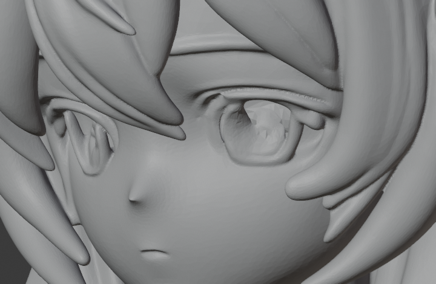
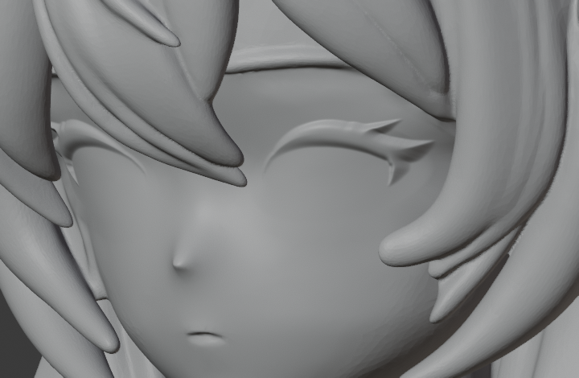

# Anime Figurine Face Refinement

[简体中文](README.md) · English

A Chinese-language Agent Skill for refining anime figurine faces in 3D. It helps you choose a base mesh, match the character reference, edit specific facial features, and review changes in Blender from fixed viewpoints. It works with editable base meshes from tools such as Hi3D and covers nose tips, eyelids, smooth eye surfaces for painting or texturing, raised eyelashes, and eye corners hidden by bangs.

## Before and after

Fixed-camera Blender clay renders of the Dafeiyu figurine. From the original v0 mesh to the final v15 face, the raised eye details and uneven eye contours were smoothed, and the upper lashes were reshaped to extend toward the temple. [Read the case study in Chinese](skills/figurine-face-refinement/references/case-study.md).

| v0 · Original mesh | v15 · Final face |
| --- | --- |
|  |  |

## Quick start

1. Prepare an editable model and character references.
2. [Install the skill](README.en.md#install-in-codex), then invoke `$figurine-face-refinement` in Codex.
3. Say what to change, what to preserve, and ask for before and after renders from the same camera.

This README is available in English. The skill and its reference guides are primarily in Chinese.

[Read the v1.1 release notes](https://github.com/zyz292/figurine-face-refinement/releases/tag/v1.1)

## What's new in v1.1

- Start a new character with the [character record template](skills/figurine-face-refinement/templates/face-record.json). For an existing character, resume from the [last approved model and saved viewpoints](skills/figurine-face-refinement/references/character-record.md).
- Remove unwanted ridges or relief from the eye surface with the [eye surface tool](skills/figurine-face-refinement/references/eye-surface.md). Identify the skin and surrounding intact surface, then assign vertices to the edit, reference, and protection groups.
- Use the [region comparison tool](skills/figurine-face-refinement/references/region-review.md) to compare the original and edited meshes from the same viewpoint.

When evaluating the workflow on a new character, track initial setup time, total time to approval, token usage, reviewer corrections, and unintended changes to approved areas. Use the same brief and acceptance criteria when comparing runs.

## Getting started

1. Prepare an editable model, character references, and the most recently approved version, if available. If you have a finished sculpt as a reference, point out the feature you want to match.
2. Invoke `$figurine-face-refinement` in Codex. Other Agent Skills clients can import the entire skill directory. An agent without skill support can start at [SKILL.md](skills/figurine-face-refinement/SKILL.md) and follow its references.
3. Describe the visible changes and what to preserve. For example: “Extend the outer upper lashes toward the temple. Keep the approved lash-root thickness and the clear space below the eye. Show before and after clay renders from the same angle.”

## Install in Codex

```sh
git clone https://github.com/zyz292/figurine-face-refinement.git
cd figurine-face-refinement
```

On Windows, run in PowerShell from the repository root:

```powershell
$skillRoot = if ($env:CODEX_HOME) { Join-Path $env:CODEX_HOME 'skills' } else { Join-Path $HOME '.codex/skills' }
New-Item -ItemType Directory -Path $skillRoot -Force | Out-Null
$target = Join-Path $skillRoot 'figurine-face-refinement'
if (Test-Path $target) { throw "Skill already exists. Compare versions before replacing it: $target" }
Copy-Item -LiteralPath 'skills/figurine-face-refinement' -Destination $target -Recurse
```

On macOS or Linux, run from the repository root:

```sh
root="${CODEX_HOME:-$HOME/.codex}/skills"
mkdir -p "$root"
test ! -e "$root/figurine-face-refinement" && cp -R skills/figurine-face-refinement "$root/"
```

Invoke the skill by name in a new session. For standalone clay renders, record the world coordinates of both eye centers and the chin. Reuse those points across revisions of the same character. See the [clay review guide](skills/figurine-face-refinement/references/clay-review.md) for sample JSON, commands, and camera angles.

## Repository contents

| Resource | What it covers |
| --- | --- |
| [Face refinement workflow](skills/figurine-face-refinement/SKILL.md) | Choosing a base mesh, distinguishing geometry from texture, editing, and review |
| [Local mesh repair](skills/figurine-face-refinement/references/mesh-repair.md) | Isolating skin and hair, smoothing eye corners, protecting face data, and shaping continuous relief |
| [Case study](skills/figurine-face-refinement/references/case-study.md) | Comparing three base meshes and reviewing lash thickness, upward sweep, and outward extension through v15 |
| [Blender review tool](skills/figurine-face-refinement/scripts/clay_views.py) | Rendering orthographic clay views at the same scale from three landmarks |
| [Project checks](tests/check_project.py) | Checking the distribution layout, documentation links, and optional Blender rendering |

## Validation

The checks require Python 3.9 or newer. The first command uses only the Python standard library. The Blender checks accept the executable name or its full path. The region comparison test uses Pillow.

```sh
python tests/check_project.py
python tests/check_project.py --blender blender
python tests/test_eye_surface.py --blender blender
python tests/test_compare_region.py
```

The eye surface tool was tested on a synthetic mesh with raised details and a protected area. Region comparisons were verified on the original and refined Beryl models. In Blender 5.2.1, the clay review tool rendered five matching views each of the v14 and v15 case-study meshes. Quality, time, and token usage across new characters remain to be evaluated.

The repository includes the workflow, written examples, and tools. Supply your own models and character references. The project follows the [Agent Skills](https://github.com/agentskills/agentskills) directory format.

## License and contributing

The code and documentation in this repository are licensed under the [MIT License](LICENSE). User-supplied models, character references, and other third-party assets are subject to their own terms.

See the [contribution guide](CONTRIBUTING.md#english) for bug reports and pull requests.

## Contributors

- [@zyz292](https://github.com/zyz292) — Project creator and maintainer
